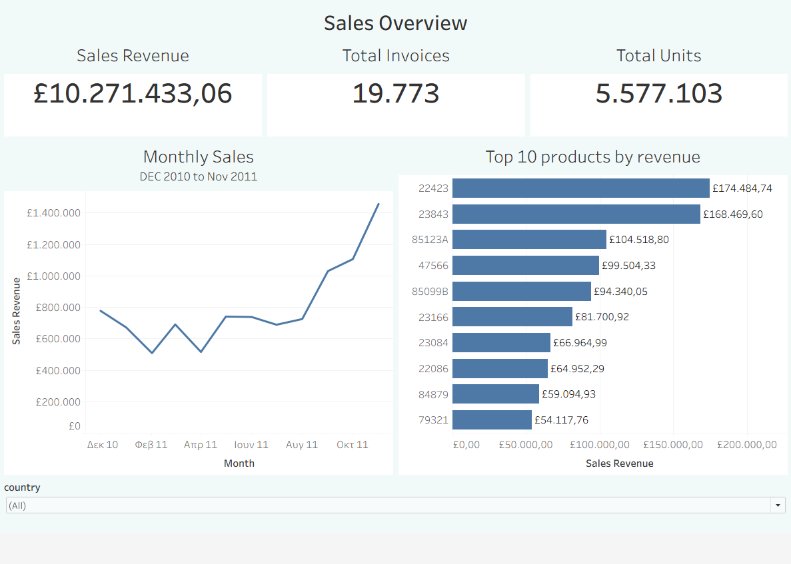
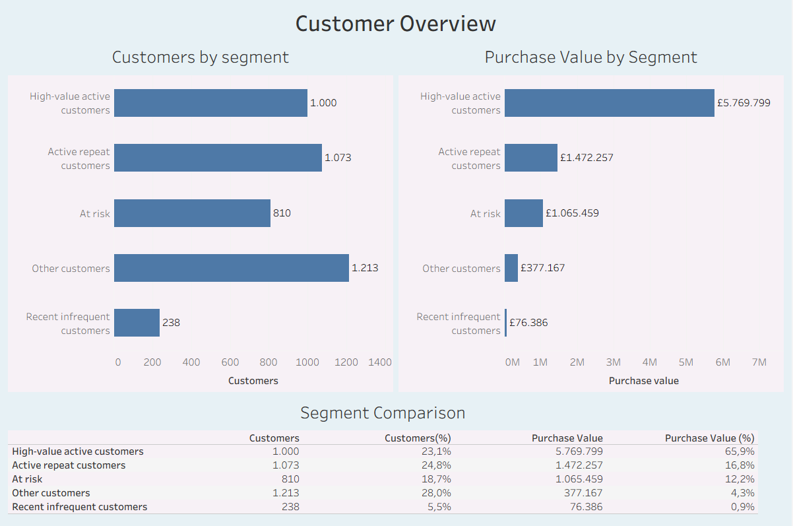

# online-retail-analysis
# Ανάλυση Πωλήσεων και Πελατών Ηλεκτρονικού Καταστήματος

## 1. Σκοπός του project

Στόχος του project είναι η ανάλυση των πωλήσεων προϊόντων και της αγοραστικής συμπεριφοράς των πελατών ενός ηλεκτρονικού καταστήματος με χρήση MySQL και Tableau.

Η ανάλυση επικεντρώνεται στα ακόλουθα επιχειρηματικά ερωτήματα:
- Ποιοι μήνες εμφανίζουν υψηλότερη και χαμηλότερη αξία πωλήσεων;
- Ποια προϊόντα συνεισφέρουν περισσότερο στην αξία πωλήσεων;
- Ποιες ομάδες πελατών έχουν υψηλή αξία αγορών και πρόσφατη δραστηριότητα και ποιες έχουν καιρό να αγοράσουν;
- Πόσο συγκεντρώνεται η αξία αγορών στις διαφορετικές ομάδες πελατών;

Προηγήθηκαν έλεγχοι,καθαρισμος και προετοιμασία των δεδομένων. Στη συνέχεια πραγματοποιήθηκαν ανάλυση πωλήσεων και ομαδοποίηση πελατών με τη μέθοδο RFM. Τα αποτελέσματα παρουσιάζονται σε δύο  dashboards στο Tableau.
---
## 2. Δεδομένα και εργαλεία

### Πηγή και περιεχόμενο

Χρησιμοποιήθηκε το Online Retail dataset, το οποίο διατίθεται στο Kaggle και προέρχεται από το UCI Machine Learning Repository.

- [Dataset στο Kaggle](https://www.kaggle.com/datasets/carrie1/ecommerce-data)
- [Αρχική πηγή στο UCI](https://archive.ics.uci.edu/dataset/352/online+retail)

Το dataset αφορά ηλεκτρονικό κατάστημα από το Ηνωμένο Βασίλειο για την περίοδο 01/12/2010–09/12/2011 ,οι τιμές  εκφράζονται σε £.
Παρακάτω τα δεδομένα μας:
| Μεταβλητή | Περιγραφή |
|-----|---|
| InvoiceNo |Αριθμός παραστατικού. |
| StockCode |Κωδικός προϊόντος. |
| Description |Περιγραφή προϊόντος ή κίνησης. |
| Quantity |Ποσότητα της καταχώρισης. |
| InvoiceDate |Ημερομηνία και ώρα παραστατικού. |
| UnitPrice |Τιμή μονάδας. |
| CustomerID |Κωδικός πελάτη. |
| Country |Χώρα πελάτη. |

Το αρχείο περιλαμβάνει επίσης ακυρωτικά και ειδικές καταχωρίσεις, όπως μεταφορικά και άλλες χρεώσεις. Επομένως, πριν από την ανάλυση χρειάστηκε να οριστεί ποιες γραμμές θα χρησιμοποιησουμε για τις πωλήσεις προϊόντων.
### Εργαλεία
- **MySQL:** αποθήκευση δεδομένων, έλεγχοι,καθαρισμός,μετατροπές, ανάλυση πωλήσεων και υπολογισμός RFM.
- **DBeaver:** περιβάλλον σύνδεσης στη MySQL, εκτέλεσης SQL scripts και εισαγωγής/εξαγωγής CSV.
- **Tableau Public:** δημιουργία γραφημάτων, συγκρίσεων και  dashboards.
---
## 3. Εισαγωγή και έλεγχοι  δεδομένων

### Διατήρηση των αρχικών δεδομένων

Το CSV εισήχθη στη MySQL μέσω DBeaver, στον πίνακα `retail_raw`. Όλες οι στήλες αποθηκεύτηκαν αρχικά ως κείμενο (`VARCHAR`).

Η επιλογή αυτή επέτρεψε να ελεγχθούν οι αρχικές τιμές πριν από τη μετατροπή τους σε αριθμούς και ημερομηνίες. Ο έλεγχος μετά την εισαγωγή επιβεβαίωσε 541.909 γραμμές, όσες και στο αρχικό αρχείο.

### Έλεγχος τιμών που λείπουν

Ελέγχθηκαν όλες οι στήλες για `NULL`, κενό κείμενο και τιμές που περιέχουν μόνο κενά διαστήματα.

| Πεδίο | Γραμμές χωρίς τιμή |
|---|---:|
| CustomerID | 135.080 |
| Description | 1.454 |
| Υπόλοιπα πεδία | 0 |

Οι γραμμές χωρίς κωδικό πελάτη δεν διαγράφηκαν, καθώς μπορούν να χρησιμοποιηθούν στην ανάλυση πωλήσεων. Δεν μπορούν όμως να αποδοθούν σε συγκεκριμένο πελάτη για τον υπολογισμό RFM.

### Έλεγχος επαναλαμβανόμενων γραμμών

Αναζητήθηκαν καταχωρίσεις με ίδιες τιμές και στις οκτώ στήλες, χρησιμοποιώντας `GROUP BY` και `HAVING COUNT(*) > 1`.

Εντοπίστηκαν επαναλήψεις, αλλά διατηρήθηκαν. Δεν υπήρχε επιβεβαίωση από την πηγή ότι πρόκειται για λανθασμένες διπλές καταχωρίσεις.

### Έλεγχος ποσότητας και τιμής

| Έλεγχος | Αριθμός γραμμών |
|---|---:|
| Αρνητική ποσότητα | 10.624 |
| Μηδενική ποσότητα | 0 |
| Αρνητική τιμή μονάδας | 2 |
| Μηδενική τιμή μονάδας | 2.515 |

Οι τιμές μονάδας ελέγχθηκαν με ακρίβεια τριών δεκαδικών, ώστε μικρές θετικές τιμές να μη στρογγυλοποιούνται σε μηδέν.

Από τις γραμμές με αρνητική ποσότητα:
- 9.288 είχαν παραστατικό που άρχιζε από `C`,δηλαδή ακύρωση.
- 1.336 δεν είχαν `C` και όλες είχαν μηδενική τιμή.

Επομένως, η αρνητική ποσότητα δεν χρησιμοποιήθηκε από μόνη της ως απόδειξη ακύρωσης. Οι δύο αρνητικές τιμές είχαν περιγραφή `Adjust bad debt`.

### Έλεγχος ημερομηνιών

Οι ημερομηνίες ελέγχθηκαν με τη μορφή μήνας/ημέρα/έτος και ώρα.

Η περίοδος εκτείνεται από 01/12/2010 έως 09/12/2011. Ο Δεκέμβριος 2011 είναι ελλιπής και γι’ αυτό εξαιρέθηκε από το μηνιαίο γράφημα σύγκρισης.

Οι παραπάνω έλεγχοι περιλαμβάνονται στο [02_data_cleaning.sql](sql/02_data_cleaning.sql).
---
## 4. Καθαρισμός και επιλογή δεδομένων για ανάλυση

### Δημιουργία του καθαρισμένου πίνακα

Από τον `retail_raw` δημιουργήθηκε ο πίνακας `retail_clean`, με τις ακόλουθες μετατροπές:

- Αφαίρεση εξωτερικών κενών από τα πεδία κειμένου με `TRIM()`.
- Μετατροπή των άδειων περιγραφών και κωδικών πελατών σε `NULL` με `NULLIF()`.
- Μετατροπή της ποσότητας σε ακέραιο αριθμό.
- Μετατροπή της τιμής μονάδας σε `DECIMAL(12,3)`.
- Μετατροπή της ημερομηνίας από κείμενο σε ημερομηνία και ώρα.

Οι κωδικοί παραστατικού, προϊόντος και πελάτη διατηρήθηκαν ως κείμενο, καθώς είναι αναγνωριστικά και όχι μεγέθη για αριθμητικούς υπολογισμούς.

Ο `retail_clean` διατήρησε και τις 541.909 γραμμές. Σε αυτό το στάδιο δεν αφαιρέθηκαν ακυρωτικά, επαναλήψεις ή κινήσεις με μηδενικές και αρνητικές τιμές.

### Επιλογή πληρωμένων πωλήσεων

Δημιουργήθηκε το view `retail_sales`, το οποίο επιλέγει γραμμές με:

- Θετική ποσότητα.
- Θετική τιμή μονάδας.
- Αριθμό παραστατικού που δεν αρχίζει από `C`.

Τα φίλτρα αυτά επιλέγουν κινήσεις με θετική καταγεγραμμένη αξία, αλλά δεν εξασφαλίζουν ότι όλες αφορούν προϊόντα.

### Διαχωρισμός προϊόντων από ειδικές καταχωρίσεις

Κατά την εξέταση των κορυφαίων κωδικών εντοπίστηκαν άλλες χρεώσεις. Εξετάστηκαν οι περιγραφές τους και δημιουργήθηκε το view `retail_product_sales`, εξαιρώντας:

| Κωδικοί| 
|---|
| DOT, POST, C2 | 
| AMAZONFEE, BANK CHARGES | 
| B |
| M |
| S |
| gift_0001_10 έως gift_0001_50 |

Το τελικό view περιλαμβάνει 527.761 γραμμές και χρησιμοποιήθηκε για την ανάλυση πωλήσεων και ως βάση για το RFM.

### Διαφορετική επιλογή για πωλήσεις και πελάτες

Στην ανάλυση πωλήσεων διατηρήθηκαν και οι γραμμές χωρίς κωδικό πελάτη.

Για το RFM επιλέχθηκαν μόνο οι γραμμές του `retail_product_sales` με διαθέσιμο `customer_id`, ώστε κάθε αγορά να συνδέεται με συγκεκριμένο πελάτη.

Οι αποκλεισμοί εφαρμόστηκαν στα views και στα queries της ανάλυσης. Οι αρχικές καταχωρίσεις παρέμειναν διαθέσιμες στους πίνακες `retail_raw` και `retail_clean`.
Δεν χαρακτηρίστηκαν όλες τις εξαιρούμενες γραμμές ως λάθη. Ορίσαμε ποιες καταχωρίσεις είναι κατάλληλες για πωλήσεις προϊόντων και ποιες μπορούν επιπλέον να χρησιμοποιηθούν στην ανάλυση πελατών.

Οι κανόνες επιλογής περιλαμβάνονται στο [03_sales_analysis.sql](sql/03_sales_analysis.sql).
---
## 5. Ανάλυση πωλήσεων προϊόντων

### Συνολική δραστηριότητα

Η ανάλυση βασίστηκε στο view `retail_product_sales`, με τα ακόλουθα αποτελέσματα:

| Δείκτης | Αποτέλεσμα |
|---|---:|
| Παραστατικά με επιλεγμένες πωλήσεις προϊόντων | 19.773 |
| Συνολικά τεμάχια | 5.577.103 |
| Συνολική αξία πωλήσεων προϊόντων | £10.271.433,06 |

Κάθε παραστατικό μετρήθηκε μία φορά με `COUNT(DISTINCT invoice_no)`, ανεξάρτητα από το πόσες γραμμές προϊόντων περιλαμβάνει.

Η αξία πωλήσεων υπολογίστηκε ως:

**Άθροισμα ποσότητας × τιμής μονάδας**

### Μηνιαία εξέλιξη

Για να εξεταστεί η μεταβολή της δραστηριότητας, υπολογίστηκε η αξία πωλήσεων ανά έτος και μήνα.

Στο διάστημα Δεκεμβρίου 2010–Νοεμβρίου 2011 παρατηρείται άνοδος της αξίας πωλήσεων από τον Σεπτέμβριο έως τον Νοέμβριο, με τον Νοέμβριο να εμφανίζει την υψηλότερη τιμή.

Ο Δεκέμβριος 2011 εξαιρέθηκε μόνο από το μηνιαίο γράφημα, επειδή τα δεδομένα του φτάνουν έως τις 9 Δεκεμβρίου.

### Προϊόντα με τη μεγαλύτερη αξία πωλήσεων

Τα προϊόντα ομαδοποιήθηκαν ανά `stock_code` και ταξινομήθηκαν βάσει της συνολικής αξίας πωλήσεών τους.

Η ομαδοποίηση έγινε βάσει κωδικού, ώστε διαφορετικές περιγραφές του ίδιου προϊόντος να μη δημιουργούν ξεχωριστές ομάδες.

Η κατάταξη δείχνει τη συνεισφορά στην αξία πωλήσεων, όχι την κερδοφορία των προϊόντων, καθώς δεν υπάρχουν δεδομένα κόστους.

### Dashboard: Sales Overview

Το dashboard συνδυάζει:
- Τρεις κάρτες συνολικών μεγεθών.
- Γράφημα μηνιαίας αξίας πωλήσεων.
- Τα δέκα προϊόντα με τη μεγαλύτερη αξία πωλήσεων.
- Φίλτρο χώρας που ενημερώνει τις κάρτες και τα γραφήματα.

Η κατάταξη των κορυφαίων προϊόντων επανυπολογίζεται για την επιλεγμένη χώρα, μέσω φίλτρου context στο Tableau.

Οι υπολογισμοί περιλαμβάνονται στο [03_sales_analysis.sql](sql/03_sales_analysis.sql).

---
## 6. Ανάλυση πελατών με τη μέθοδο RFM

### Στόχος και επιλογή πελατών

Η μέθοδος RFM χρησιμοποιήθηκε για την ομαδοποίηση των πελατών βάσει της καταγεγραμμένης αγοραστικής τους συμπεριφοράς.

Χρησιμοποιήθηκαν οι πωλήσεις του `retail_product_sales` με διαθέσιμο κωδικό πελάτη. Προέκυψαν 4.334 διαφορετικοί πελάτες.

Για κάθε πελάτη υπολογίστηκαν:

| Μέγεθος | Ορισμός | Υπολογισμός |
|---|---|---|
| Recency | Ημέρες από την τελευταία αγορά έως την ημερομηνία αναφοράς | `DATEDIFF('2011-12-10', MAX(invoice_date))` |
| Frequency | Αριθμός διαφορετικών παραστατικών αγοράς | `COUNT(DISTINCT invoice_no)` |
| Monetary | Συνολική αξία αγορών προϊόντων | `SUM(quantity * unit_price)` |

Ως ημερομηνία αναφοράς ορίστηκε η 10/12/2011, μία ημέρα μετά το τέλος των δεδομένων.

Η συχνότητα υπολογίστηκε ανά διαφορετικό παραστατικό και όχι ανά γραμμή προϊόντος. Η αξία αγορών εκφράζεται σε λίρες στερλίνες, πριν από την αφαίρεση ακυρώσεων.

Τα αποτελέσματα αποθηκεύτηκαν στον πίνακα `customer_rfm`, με μία γραμμή ανά πελάτη.

### Βαθμολογίες R, F και M

Κάθε μέγεθος μετατράπηκε σε σχετική βαθμολογία από 1 έως 5:

- Μικρότερο Recency σημαίνει πιο πρόσφατη αγορά και υψηλότερη βαθμολογία.
- Μεγαλύτερο Frequency σημαίνει περισσότερες αγορές και υψηλότερη βαθμολογία.
- Μεγαλύτερο Monetary σημαίνει υψηλότερη αξία αγορών και υψηλότερη βαθμολογία.

Χρησιμοποιήθηκε η συνάρτηση `CUME_DIST()` για τη σχετική θέση κάθε πελάτη στην αντίστοιχη κατανομή. Το αποτέλεσμα πολλαπλασιάστηκε επί 5 και στρογγυλοποιήθηκε προς τα πάνω με `CEIL()`.

Οι πελάτες με ίδια τιμή στο ίδιο μέγεθος έλαβαν την ίδια βαθμολογία. Επομένως, οι βαθμολογικές ομάδες δεν έχουν απαραίτητα ίσο πλήθος πελατών ούτε εμφανίζονται υποχρεωτικά και οι πέντε βαθμοί σε κάθε μέγεθος.

Οι βαθμολογίες περιγράφουν τη σχετική θέση των πελατών στο συγκεκριμένο dataset και δεν αποτελούν καθολικά επιχειρηματικά όρια.

### Κανόνες ομαδοποίησης

Με βάση τις βαθμολογίες δημιουργήθηκαν πέντε ομάδες:

| Ομάδα | Κριτήρια |
|---|---|
| High-value active customers | R ≥ 4, F ≥ 4 και M ≥ 4 |
| Active repeat customers | R ≥ 3 και F ≥ 3, εφόσον δεν έχουν ενταχθεί στην προηγούμενη ομάδα |
| At risk | R ≤ 2 και τουλάχιστον ένα από F ≥ 3 ή M ≥ 4 |
| Recent infrequent customers | R ≥ 4 και F ≤ 2 |
| Other customers | Πελάτες που δεν καλύπτουν κάποιον από τους παραπάνω κανόνες |

Η ταξινόμηση υλοποιήθηκε με `CASE`. Οι κανόνες εξετάζονται με την παραπάνω σειρά και κάθε πελάτης εντάσσεται στην πρώτη ομάδα της οποίας πληροί τα κριτήρια.

Οι κανόνες επιλέχθηκαν για τις ανάγκες του project. Η ομάδα `At risk` υποδηλώνει πελάτες με παλαιότερη δραστηριότητα και σχετικά υψηλή συχνότητα ή αξία αγορών· δεν αποτελεί πρόβλεψη ή επιβεβαίωση αποχώρησης.

Οι υπολογισμοί και η ομαδοποίηση περιλαμβάνονται στο [04_rfm_analysis.sql](sql/04_rfm_analysis.sql).
---
## 7. Σύγκριση ομάδων πελατών και βασικά ευρήματα

Η σύγκριση βασίστηκε στον αριθμό πελατών και στη συνολική αξία αγορών κάθε ομάδας.

| Ομάδα | Πελάτες | Ποσοστό πελατών | Ποσοστό αξίας αγορών |
|---|---:|---:|---:|
| High-value active customers | 1.000 | 23,1% | 65,9% |
| Active repeat customers | 1.073 | 24,8% | 16,8% |
| At risk | 810 | 18,7% | 12,2% |
| Other customers | 1.213 | 28,0% | 4,3% |
| Recent infrequent customers | 238 | 5,5% | 0,9% |

Τα ποσοστά αξίας αγορών υπολογίζονται επί των αγορών των 4.334 αναγνωρισμένων πελατών.

### Συγκέντρωση της αξίας αγορών

Οι High-value active customers αποτελούν το 23,1% των πελατών, αλλά αντιστοιχούν στο 65,9% της αξίας αγορών.Λιγότερο από το ένα τέταρτο των πελατών αντιπροσωπεύει σχεδόν τα δύο τρίτα της αξίας.

### Πελάτες με παλαιότερη δραστηριότητα και σημαντική αξία

Οι 810 πελάτες της ομάδας At risk αντιπροσωπεύουν αξία αγορών περίπου £1,07 εκατ.

### Το πλήθος πελατών δεν ισοδυναμεί με αντίστοιχη αξία αγορών

Οι Other customers είναι η μεγαλύτερη ομάδα, με 28,0% των πελατών, αλλά συνεισφέρουν το 4,3% της αξίας αγορών.

### Πρόσφατοι πελάτες με χαμηλή συχνότητα

Οι Recent infrequent customers αποτελούν το 5,5% των πελατών και το 0,9% της αξίας αγορών.

### Dashboard: Customer Overview

Το dashboard παρουσιάζει:
- Τον αριθμό πελατών ανά ομάδα.
- Τη συνολική αξία αγορών ανά ομάδα.
- Πίνακα σύγκρισης πραγματικών τιμών και ποσοστών.

Οι ομάδες εμφανίζονται με την ίδια σειρά, ώστε να διευκολύνεται η σύγκριση μεταξύ πλήθους πελατών και αξίας αγορών.

---
## Διευκρινήσεις για την ερμηνεία των αποτελεσμάτων
- **Ακυρώσεις:** υπολογίσαμε την αξία των επιλεγμένων πωλήσεων προϊόντων, χωρίς να αφαιρέσουμε στη συνέχεια τα ποσά των ακυρωτικών.
- **Κέρδος:** τα ποσά δείχνουν αξία πωλήσεων, όχι κέρδος, επειδή δεν διαθέτουμε στοιχεία για το κόστος των προϊόντων.
- **Κωδικοί πελατών:** οι πωλήσεις χωρίς CustomerID συμπεριλήφθηκαν στην ανάλυση πωλήσεων, αλλά εξαιρέθηκαν από το RFM, επειδή δεν μπορούσαν να συνδεθούν με συγκεκριμένο πελάτη.
- **Επαναλαμβανόμενες γραμμές:** διατηρήθηκαν επειδή δεν γνωρίζουμε αν είναι λάθη ή πραγματικές ξεχωριστές καταχωρίσεις.
  
